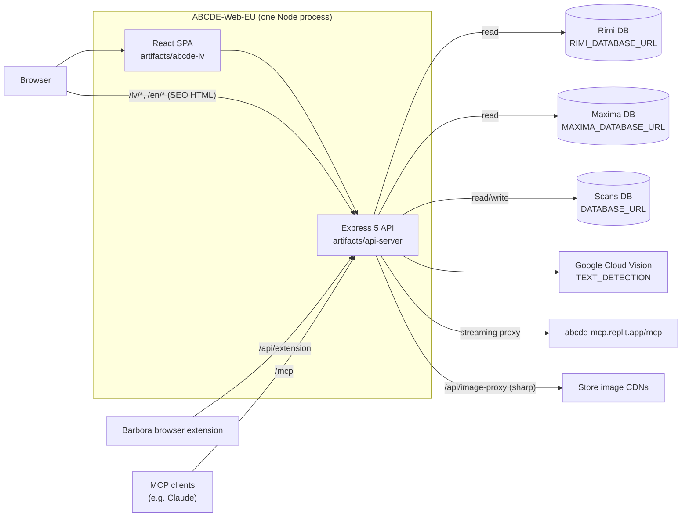
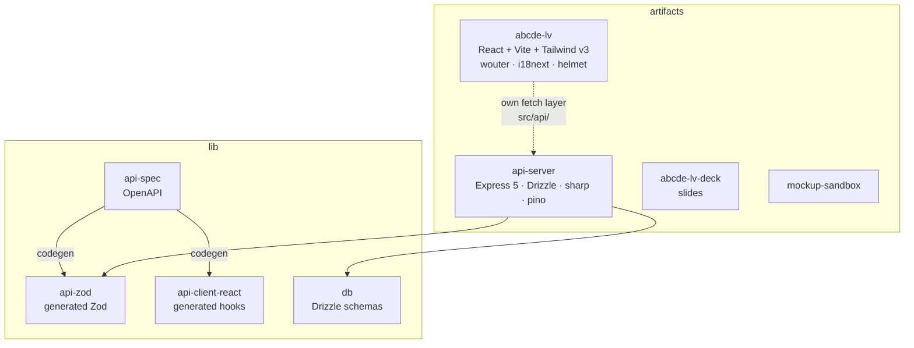
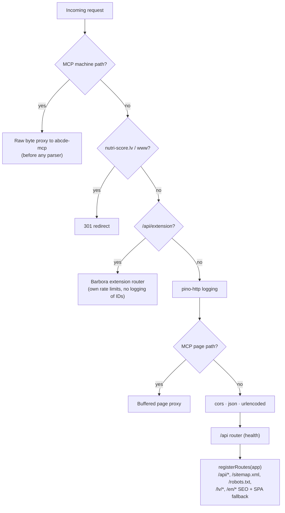
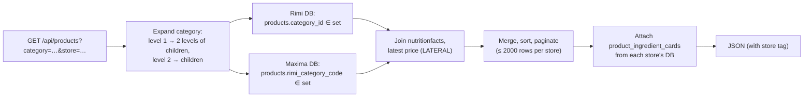
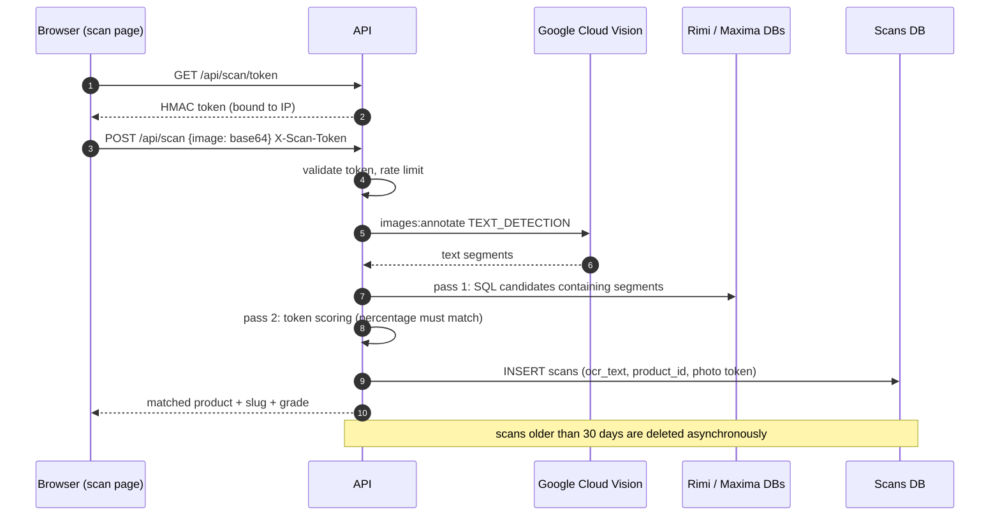

# ABCDE-Web-EU Architecture

ABCDE-Web-EU is the source of [abcde.lv](https://abcde.lv), a public website in Latvian and English. It shows Nutri-Score grades for food sold at Rimi and Maxima. The site doesn't scrape anything itself: it reads databases written by [RimiScraper-v2](https://github.com/yuri-ivanov1972/RimiScraper-v2) and [BarboraScraper-v1](https://github.com/yuri-ivanov1972/BarboraScraper-v1), and its own database holds only scan records.

## System context

Both scraper databases are hosted on Neon. The site connects through `@neondatabase/serverless` over WebSockets, using one pool per database (`max: 5`, 1-hour connection lifetime) and a Drizzle client for each. If `MAXIMA_DATABASE_URL` is missing, the site still works with only Rimi products.

## Monorepo layout

The OpenAPI spec covers only newer endpoints, such as the extension lookup. The main application routes predate it and are written by hand in `routes/routes.ts`. The frontend calls them through its own fetch layer in `src/api/`.

`lib/db` has two schemas:

- `schema/schema.ts` defines the local `scans` table.
- `server/remote-schema.ts` defines Drizzle mappings of the scraper tables: `normalized_categories`, `products` (Rimi and Maxima versions), `nutritionfacts`, `productphotos` and `product_price_history`.

## Request handling

Middleware order in `app.ts` and `index.ts` matters:

### Main endpoints (`routes/routes.ts`)

| Endpoint | Purpose |
|---|---|
| `GET /api/categories`, `/api/categories/:id`, `…/path` | Category tree. This always comes from Rimi's `normalized_categories`. |
| `GET /api/categories/:id/has-healthier-products` | Checks whether the category has products with better grades. |
| `GET /api/products` | Filtered, paginated list from Rimi, Maxima or both. |
| `GET /api/products/:id`, `/sku/:sku`, `/url/:url` | Product detail |
| `GET /api/scan/token`, `POST /api/scan` | Photo-of-label scan |
| `POST /api/mobile/match-text`, `GET /api/mobile/product/:store/:id` | Mobile app matching from text |
| `GET /api/stats/nutri-score-distribution` | Statistics for the "What Latvians eat" page |
| `GET /api/reports/ice-cream` | Ice-cream report |
| `GET /api/image-proxy` | Fetches store images and resizes them with `sharp` |
| `GET /lv/product/:slug`, `/en/category/:slug`, … | Server-side HTML with meta tags for SEO |
| `GET /sitemap.xml`, `/robots.txt` | Crawler support |

## Combining Rimi and Maxima

Rimi's category tree is used for both stores. Each Maxima product has a `rimi_category_code`, which holds a Rimi `category_id`, so the site can put it in the same tree:

A **healthier alternative** is a product in the same expanded category with a better grade. For a product with grade $g \in \{C, D, E\}$, the better grades are

$$
\text{better}(g) = \{\, h \in \{A,B,C,D,E\} : h \prec g \,\}
$$

where $\prec$ is the order $A \prec B \prec C \prec D \prec E$. Category IDs 5 and 40 ("Gatavots Rimi", Rimi's own ready meals) are excluded.

## Photo scan

The scan finds a product by reading the text on its package with OCR. It doesn't read barcodes.

## Barbora browser extension endpoint

`/api/extension` is a separate router mounted before logging and body parsing. It takes a list of Barbora product IDs and returns a Nutri-Score badge for each one, with an optional abcde.lv link. It has its own limits:

- per-client and per-instance rate limits
- a concurrency cap
- a deadline for each request
- `Cache-Control: no-store`

Only an aggregate status and timing are logged. Request bodies are validated with the generated `LookupBarboraNutriscoresBody` Zod schema. The contract is in `docs/barbora-extension/`.

## MCP proxy

Requests to the MCP path are passed through, byte for byte, to a fixed upstream at `https://abcde-mcp.replit.app/mcp`. This happens before any parser, redirect or logging, and only allow-listed headers are forwarded:

- Requests are limited to 32 KB.
- The upstream must be HTTPS with path `/mcp`. A localhost fixture is allowed in development.
- Allowed origins are abcde.lv, the MCP app and claude.ai/claude.com.

The MCP server itself is a separate project. `docs/abcde-mcp/` documents it.

## Caching and SEO

- `cache.ts` provides in-memory TTL caches, `productsCache` and `categoriesCache`, with 200 entries each.
- `seo.ts` and the `/lv/*` and `/en/*` handlers add titles, descriptions and canonical/hreflang links to the SPA's HTML for product and category pages. They then serve the HTML so that crawlers see real metadata.
- Old domains `nutri-score.lv` and `nutriscore.lv` redirect to `/lv/about-nutriscore`, and `www.abcde.lv` redirects to `abcde.lv`.

## Frontend

The pages are in `artifacts/abcde-lv/src/pages`:

- `home`
- `product-search`
- `product-details`
- `scan`
- `about-nutriscore`
- `about-project`
- `what-latvians-eat`
- `ice-cream-report`
- `debug`
- `not-found`

Routing uses wouter, translations come from `src/locales` (lv and en) through i18next, and head tags are set with react-helmet-async.

## Environment

| Variable | Used by |
|---|---|
| `RIMI_DATABASE_URL` | Required. Categories, Rimi products, the main lookups. |
| `MAXIMA_DATABASE_URL` | Optional. Maxima products. |
| `DATABASE_URL` | Required. Scans table. |
| `GOOGLE_CLOUD_API_KEY` | OCR for photo scans |
| `SCAN_TOKEN_SECRET` | Signs scan tokens. If it isn't set, a random secret is made at startup and tokens stop working after a restart. |
| `LOG_LEVEL`, `NODE_ENV`, `REPLIT_DEV_DOMAIN` | Logging and development settings |

The security review of this design is in `threat_model.md`.
